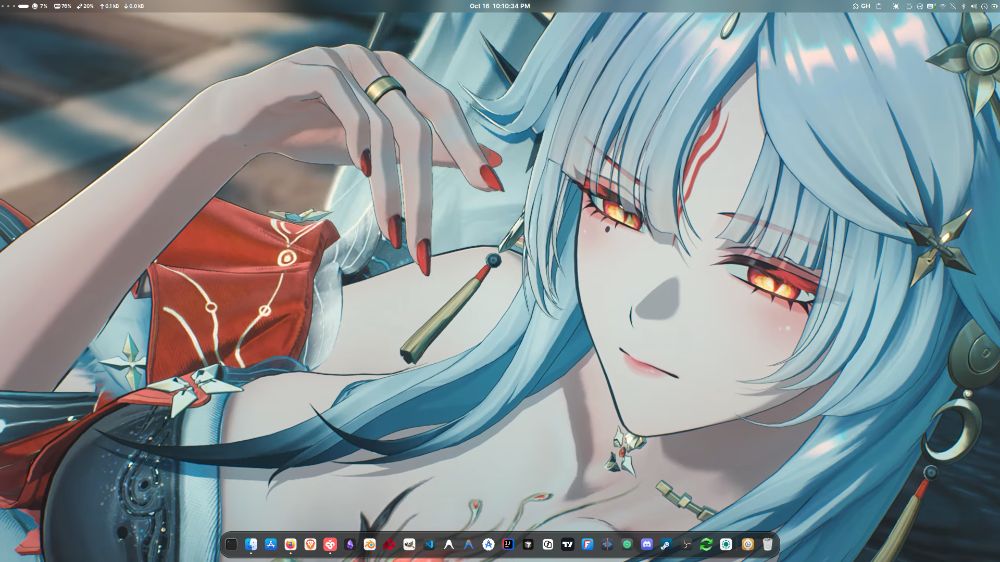

# Simple Fedora GNOME Rice

A beautiful Mac-inspired GNOME desktop customization for Fedora Linux featuring live wallpapers, useful extensions, and a polished developer-friendly environment.

## Preview



## Key Features

- 🖼️ **Live Wallpapers**: Animated wallpapers for both desktop and lock screen
- 🍎 **Mac-like Design**: Clean, elegant interface inspired by macOS aesthetics
- 🔧 **Developer Extensions**: Essential GNOME extensions for daily development workflow
- 🌫️ **Blur Effects**: Beautiful blur effects via GNOME extensions
- 💾 **Desktop Backup**: Complete GNOME desktop configuration that can be imported/exported
- ⚡ **Easy Installation**: Simple import process using GNOME's Save Desktop feature

## Tech Stack

- **Operating System**: Fedora Linux (or any GNOME-compatible distribution)
- **Desktop Environment**: GNOME Shell
- **Customization**: GNOME Extensions, Themes, Icons, Fonts
- **Live Wallpaper**: GNOME Live Wallpaper extension
- **Configuration**: dconf settings for GNOME preferences

## Prerequisites

Before using this rice, ensure you have:

- Fedora Linux (or any Linux distribution with GNOME Desktop Environment)
- GNOME Shell installed and running
- Internet connection to download required extensions
- Basic familiarity with GNOME Settings and extensions

## Getting Started

Follow these steps to install this GNOME rice on your system:

### 1. Clone the Repository

```bash
git clone https://github.com/serious-capybara/simple-fedora-rice.sd.git
cd simple-fedora-rice.sd
```

### 2. Install Save Desktop Application

Before importing, you need to have the Save Desktop application installed to import the `.sd` file.

```bash
# On Fedora:
sudo dnf install flatpak
flatpak install flathub org.gnome.SaveDesktop

# On Ubuntu/Debian:
sudo apt install flatpak
flatpak install flathub org.gnome.SaveDesktop
```

### 3. Install Required Applications

Before importing, install these essential GNOME tools:

```bash
# On Fedora:
sudo dnf install gnome-extensions-app gnome-tweaks

# On Ubuntu/Debian:
sudo apt install gnome-extensions-app gnome-tweaks

# These provide:
# - Extensions App: To manage and control GNOME extensions
# - Tweaks Tool: To adjust GNOME appearance and behavior
```

### 4. Prepare the Desktop Configuration

The rice consists of two main directories that need to be compressed together:
- `DE/` - Contains desktop extensions and related configurations
- `General/` - Contains themes, icons, fonts, and general settings

### 5. Create the Desktop Backup File

Compress both directories and save with the `.sd` extension:

```bash
# Navigate to the repository directory
cd simple-fedora-rice.sd

# Compress DE and General folders into a single archive
zip -r MyCustomDesktop.sd DE/ General/

# Optional: Rename the file as desired (must end with .sd)
# Example: zip -r MyFedoraRice.sd DE/ General/
```

### 6. Import the Desktop Configuration

1. Open the **Save Desktop** application (search for it in your applications menu)
2. Click on the **Import** section/button
3. Navigate to and select your `MyCustomDesktop.sd` file (or whatever you named it)
4. Wait for the import process to complete
5. Log out and log back in, or restart your shell (press Alt+F2, type `r`, then Enter)

### 7. Enable and Configure Extensions

After importing:

1. Open **Extensions** application
2. You should see all the extensions from this rice listed
3. Toggle them ON as needed
4. Some extensions may require additional configuration:
   - Open **Tweaks** to adjust themes, fonts, and other settings
   - Configure live wallpaper settings through the Live Wallpaper extension
   - Adjust blur effects and other visual tweaks in their respective extension settings

### 8. Recommended Extensions Included

This rice includes various useful extensions for developers, such as:
- Dash to Dock/Panel
- GSConnect (for Android integration)
- Clipboard Indicator
- System Monitor
- Weather Extension
- Workspace Indicator
- And many more productivity enhancements

## Architecture Overview

### Directory Structure

```
simple-fedora-rice.sd/
├── DE/
│   └── nautilus/
│       └── python/
│           └── extensions/     # Nautilus Python extensions
│               └── __pycache__/ # Compiled Python extensions
├── General/
│   ├── dconf-settings.ini      # GNOME dconf database backup
│   ├── fonts/                  # Custom fonts (BearSansUI, CopperplateCC, JetBrainsMono)
│   ├── gnome-shell/            # GNOME shell configurations
│   ├── gtk-4.0/                # GTK 4.0 settings
│   ├── icon-themes.tgz         # Icon themes archive
│   ├── icon-themes-legacy.tgz  # Legacy icon themes archive
│   └── sample-workspace-look.png # Preview of the desktop setup
└── README.md                   # This file
```

### Configuration Details

- **dconf-settings.ini**: Contains all GNOME settings including keyboard shortcuts, panel layout, default applications, etc.
- **Fonts**: Custom fonts for a polished mac-like appearance
- **Icon Themes**: Custom icon sets for consistent visual theme
- **Shell Extensions**: Various GNOME extensions enabled by default
- **Live Wallpaper**: Configured for both desktop and lock screen

## Environment Variables

This desktop customization doesn't require specific environment variables, but for optimal performance:

- Ensure your system meets the minimum requirements for GNOME Shell and live wallpapers
- Adequate RAM (8GB+ recommended) for smooth animations
- Graphics drivers properly installed for visual effects

## Available Scripts and Commands

While this is primarily a desktop configuration, here are useful GNOME-related commands:

```bash
# Reload GNOME Shell (after making changes)
# On Wayland (GNOME 40+), log out and log back in, or restart your session
# On Xorg, you can use Alt+F2, then type 'r' and Enter

# Enable/disable specific extensions via command line
gnome-extensions enable <extension-uuid>
gnome-extensions disable <extension-uuid>

# List installed extensions
gnome-extensions list

# Update all extensions
gnome-extensions update

# Reset GNOME to default settings (use with caution!)
dconf reset -f /org/gnome/
```

## Troubleshooting

### Common Issues and Solutions

**Issue**: Extensions not working after import
**Solution**: 
1. Make sure GNOME Extensions app is installed
2. Try restarting your session (log out and log back in) or, if on Xorg, use Alt+F2 then type 'r'
3. Check if extensions need updates in the Extensions app

**Issue**: Live wallpaper not showing
**Solution**:
1. Verify the Live Wallpaper extension is enabled
2. Check that your graphics drivers support the required visual effects
3. Try setting a static wallpaper first, then re-enable live wallpaper

**Issue**: Missing fonts or incorrect appearance
**Solution**:
1. Ensure the fonts from `General/fonts/` are properly installed
2. Use Tweaks tool to verify font settings
3. Some applications may need restart to pick up new fonts

**Issue**: Extension conflicts
**Solution**:
1. Disable extensions one by one to identify conflicts
2. Keep only essential extensions enabled
3. Check extension compatibility with your GNOME version

## Warning

⚠️ **Use at Your Own Risk**

This desktop customization is provided as-is for your personal use. While care has been taken to ensure compatibility and stability:

- The developer is not liable for any system issues, data loss, or problems that may arise from using this configuration
- Always backup your current GNOME settings before importing new configurations
- Test in a safe environment first if possible
- Some extensions may behave differently based on your specific hardware, drivers, and GNOME version
- If you encounter issues, you can always reset to default GNOME settings or manually disable problematic extensions

## Customization

Feel free to modify this rice to suit your preferences:

1. **Adding/Removing Extensions**: 
   - Edit the contents of `DE/nautilus-python/extensions/` to add/remove Nautilus extensions
   - Manage shell extensions through the Extensions app after import

2. **Changing Themes/Icons**:
   - Replace contents in `General/` directory with your preferred themes and icons
   - Update the compressed `.sd` file after making changes

3. **Modifying Settings**:
   - Edit `dconf-settings.ini` to change specific GNOME preferences
   - Use `dconf dump /` to export your current settings for reference

4. **Live Wallpaper**:
   - Replace or modify live wallpaper files through the Live Wallpaper extension settings
   - Consult the extension documentation for supported formats

## Credits

This rice combines various open-source GNOME extensions, themes, icons, and fonts created by the talented GNOME community. All credits belong to their respective authors.

## License

This configuration is shared freely for personal use. Please respect the licenses of individual components (extensions, themes, fonts, etc.) included in this rice.

---

*Created with ❤️ for the GNOME community. Enjoy your beautiful Fedora desktop!*